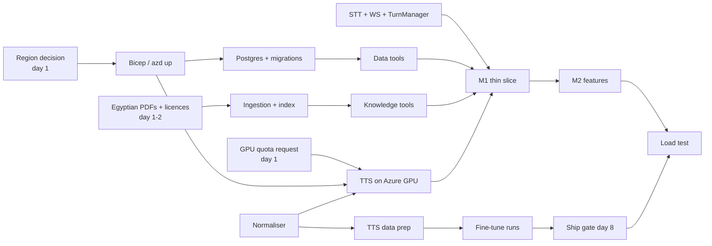

# Amina — Implementation Roadmap (v1, 2 weeks)

| | |
|---|---|
| Status | Draft for technical review |
| Team | P1 Lead (full-stack AI) · P2 Speech/TTS · P3 Data & Quality |
| Duration | 10 working days after design approval |
| Parent | [system-design.md §18](system-design.md#18-implementation-phases-and-responsibilities) |

**Planning rule:** a working, tested, deployed thin slice comes before breadth. Each milestone ends with something running on Azure that a reviewer can try.

---

## 1. Scope: essential vs optional

| Essential (v1 must ship) | Optional (only if essentials are done) | Phase 2 (designed, not built) |
|---|---|---|
| Browser call: real-time STT, streamed TTS, barge-in | Client-side VAD pre-signal for faster barge-in | ACS phone number + DTMF |
| Verification: keypad + spoken, HMAC lookup, lockouts | Grounding checker `block` mode | OTP second factor |
| Data tools with RLS; Knowledge tools with citations | `ar.lucene` vs `ar.microsoft` analyzer comparison | Staff live voice takeover |
| propose → yes → confirm actions (tickets, disputes) | Post-call LLM review score | Private endpoints for every PaaS service |
| Handoff: summary, ticket, console queue, claim | Console filters and search | HA Postgres, ≥ 2 TTS replicas |
| `amina-tts` on Azure GPU + Azure TTS fallback | DeepSpeed / fp16 inference | Turn-detection model |
| Egyptian text normaliser | Second fine-tune run | Commercially licensable TTS engine |
| XTTS fine-tune + evaluation + ship gate | | |
| Egyptian PDF corpus + ingestion + hybrid retrieval | | |
| OTel traces, latency metrics, workbook, alerts | | |
| Known-answer eval, red-team suite, Locust load test | | |
| Bicep + azd + CI/CD | | |

**Pre-agreed cut list.** If we slip, these are cut in this order:

1. optional items;
2. alerts, keeping only the dashboard;
3. the second ASR judge in the TTS evaluation;
4. the console's live transcript, falling back to a refresh-based view.

The fine-tune, RAG, load test and red-team suite are **not** on the cut list (user decision).

---

## 2. Dependencies and critical path

**Critical path:** GPU quota → `amina-tts` on Azure → the M1 slice spoken by our voice.

**Mitigation:** the M1 slice is allowed to speak with the Azure fallback voice if the GPU is still blocked. The TTS work continues locally or on the training GPU, and the switch is one configuration value.

---

## 3. Day-by-day plan

### Day 0 (before day 1, Lead)

- Design approved.
- Azure subscription access for all three, with data-plane RBAC on a dev resource group.
- **Submit quota requests:** Container Apps T4 GPU (target region), and training GPU (Azure ML or a VM family).
- Check Azure OpenAI model availability in the candidate regions.

### Week 1: foundations and the thin slice

| Day | P1 Lead | P2 Speech/TTS | P3 Data & Quality |
|---|---|---|---|
| 1 | uv workspace, repo layout, ruff/pyright/pytest, CI on PR; WS protocol types; region decision with P3 | Pin coqui-tts (T1); run NileTTS-XTTS locally; start `packages/arabic_text` | Bicep skeleton + `azd up` (RG, ACA env, ACR, PG 18, Storage, KV, AI Services, Search, App Insights); collect PDFs + licence notes |
| 2 | Browser audio (AudioWorklet capture/playback) ↔ WS ↔ Azure Speech STT; captions on screen | **Latency spike:** NileTTS-XTTS on an Azure T4 (or the closest available GPU): TTFB, RTF. `amina-tts` service skeleton + contract tests | Alembic schema, RLS, roles, `verify_lookup`, seed; DB integration tests; Easy Auth + WS check (O8) |
| 3 | TurnManager (end of turn, barge-in), Responses API streaming loop, tool registry, chunker → TTS client → downlink | Normaliser rules + tests; **baseline report** (base XTTS v2 vs NileTTS-XTTS vs Azure Salma); write the 600 banking sentences | Ingestion CLI (DI layout → page chunks → embeddings → index); Data tools; retrieval question set (40) |
| 4 | Verification flow (keypad + spoken), state machine, filler clips, Azure TTS fallback | NileTTS SPEAKER_02 prep (re-segment, filter, normalise); synthesise + select banking clips | Knowledge tools (`search_policy`, deterministic `get_fee_rule`); retrieval eval; CI/CD deploy via OIDC + migration job |
| 5 | **Integrate the M1 slice on Azure**; OTel spans per stage | Deploy `amina-tts` on the ACA T4 with the base NileTTS-XTTS; human check of the banking clips (all three help, ~20 min each) | Known-answer eval harness (text mode) + the first 20 cases; fix integration issues |

**M1, end of day 5. Thin slice deployed.**

- A reviewer opens the deployed `/call` page, verifies as a test customer, and asks the worked-example fee question.
- Amina answers with the correct amount and the correct **real PDF page**, spoken by NileTTS-XTTS (or the fallback, if the GPU is blocked, stating why).
- The trace shows every stage.
- The latency spike report is written; the provisional targets in system-design §17.3 are confirmed or revised.

### Week 2: features, fine-tune, proof

| Day | P1 Lead | P2 Speech/TTS | P3 Data & Quality |
|---|---|---|---|
| 6 | Actions (propose / yes / confirm, idempotent writes); checker (numeric grounding, flag mode) | **Fine-tune run 1** (training GPU) | Red-team suite (≥ 25 cases); eval cases to ≥ 40; privacy scan script |
| 7 | Handoff (summary, ticket, NOTIFY) + console (queue, case view, live transcript, claim) | Evaluate run-1 checkpoints; optional run 2 | Locust WS load scenario + recorded audio (12 E2E calls recorded by the team); workbook + alerts |
| 8 | Triage (async), idle handling, barge-in tuning (silence timeout, thresholds) | **Ship gate decision**; MOS/A-B listening session (team + ≥ 7 outside listeners); publish the voice artifact | Run the full evals + red-team; file issues; cost model wiring (`calls.cost_estimate_usd`) |

**M2, end of day 8. Feature complete.**

- Every essential feature works on Azure.
- The fine-tune decision is made and documented, and the chosen voice is deployed.
- The eval and red-team suites run against the deployed system.

| Day | P1 Lead | P2 Speech/TTS | P3 Data & Quality |
|---|---|---|---|
| 9 | Fix eval and red-team failures; latency optimisations from the measured breakdown | TTS capacity test (knee per T4); DeepSpeed/fp16 decision if time allows | **Load test** (5 → 25 calls); audio E2E runs; privacy scan |
| 10 | Freeze; README + runbook; update the docs with measured numbers | TTS report (baseline, fine-tune, gate, latency) | Acceptance criteria report (A1–A11); demo data reset |

**M3, end of day 10. Hardened and demo-ready.**

- The acceptance report shows each criterion from system-design §17 as pass or fail, with evidence.
- The design docs are updated with measured values; every *Target* is either met or explained.
- The demo is rehearsed twice on the deployed environment.

---

## 4. Ways of working

- **Branching:** short-lived feature branches from `main`; PRs need one reviewer (the Lead reviews all of P2's and P3's PRs; P3 reviews the Lead's). CI must be green: lint, types, unit and integration tests.
- **Definition of done:** code + tests + traces for new stages + docs touched where behaviour changed + deployed to dev.
- **Daily:** a 15-minute sync on blockers and the critical path (quota, GPU, M-gates).
- **Decisions:** any change to a decision in [decisions.md](decisions.md) is made in a PR that updates the ADR.
- **Secrets:** none in the repo. `.env` files are only for non-secret config (resource names).

---

## 5. Risks to the schedule

| Risk | Early signal | Response |
|---|---|---|
| GPU quota late | Quota not granted by the end of day 2 | M1 ships on the fallback voice; P2 continues on the training GPU; GPU VM per [ADR-003](decisions.md#adr-003-tts-hosting-container-apps-serverless-gpu) as plan B |
| T4 TTFB too high | Day-2 spike p95 > 1 s | Measure DeepSpeed/fp16; earlier first-clause chunking; A100 profile if capacity allows; present the breakdown honestly |
| Fine-tune doesn't help | Run-1 eval below gate | Ship base + normaliser (a planned outcome) |
| Arabic PDFs are low quality | Day-3 OCR sampling | Replace sources; prefer born-digital PDFs |
| Turn-taking feels poor | Day-5 internal calls | Day-8 tuning slot; the parameters are config, not code |
| Integration crunch on day 5 | Day 4 without end-to-end audio | Lead pairs with P3 on day 4 afternoon; cut optional items |
