# Amina — System Design (v1)

| | |
|---|---|
| Status | **Draft for technical review** |
| Date | 2026-11-02 |
| Scope | Banking voice support agent "Amina", Egyptian Arabic, deployed on Azure, browser caller |
| Companion documents | [decisions.md](decisions.md) (ADRs) · [tts.md](tts.md) (custom TTS) · [roadmap.md](roadmap.md) (plan) |
| Source deck | [Banking Voice AI Support Agent.pdf](../reference/Banking%20Voice%20AI%20Support%20Agent.pdf) |

**How to read the labels in this document**

- **Confirmed**: verified against official documentation or a primary source (linked).
- **Decision**: a choice we made. The reasoning and the rejected alternatives are in [decisions.md](decisions.md).
- **Assumption**: believed true but not yet verified. It has a named check in the roadmap.
- **Target**: a measurable goal we commit to measuring. It is not a claimed capability.
- **Open**: unresolved. Listed in §19.

---

## Contents

1. [Project overview, requirements and scope](#1-project-overview-requirements-and-scope)
2. [Functional and non-functional requirements](#2-functional-and-non-functional-requirements)
3. [High-level architecture and component responsibilities](#3-high-level-architecture-and-component-responsibilities)
4. [Detailed component architecture](#4-detailed-component-architecture)
5. [Architecture decisions (summary)](#5-architecture-decisions-summary)
6. [Request and audio data flows](#6-request-and-audio-data-flows)
7. [Speech-to-text, LLM and custom TTS integration](#7-speech-to-text-llm-and-custom-tts-integration)
8. [TTS training, evaluation and inference architecture](#8-tts-training-evaluation-and-inference-architecture)
9. [Agent and tool execution workflows](#9-agent-and-tool-execution-workflows)
10. [PostgreSQL database design](#10-postgresql-database-design)
11. [RAG architecture and document ingestion](#11-rag-architecture-and-document-ingestion)
12. [Authentication, authorization and security boundaries](#12-authentication-authorization-and-security-boundaries)
13. [Error handling, retries, fallbacks and failure scenarios](#13-error-handling-retries-fallbacks-and-failure-scenarios)
14. [Real-time communication and concurrency](#14-real-time-communication-and-concurrency)
15. [Azure infrastructure and deployment](#15-azure-infrastructure-and-deployment)
16. [Logging, tracing, monitoring and cost](#16-logging-tracing-monitoring-and-cost)
17. [Testing strategy and acceptance criteria](#17-testing-strategy-and-acceptance-criteria)
18. [Implementation phases and responsibilities](#18-implementation-phases-and-responsibilities)
19. [Risks, trade-offs and open decisions](#19-risks-trade-offs-and-open-decisions)

---

## 1. Project overview, requirements and scope

### 1.1 Problem

Callers phone the bank about fees, blocked cards, transfers and disputes. A human agent has to look up the customer's records in one system and the bank's rules in another. Calls queue, and two agents can read the same policy differently (deck, slide 2).

### 1.2 What Amina is

Amina is a voice agent that speaks Egyptian Arabic. She:

1. verifies the caller;
2. answers from **that customer's own records** (PostgreSQL) and from **the bank's policy documents** (real Egyptian PDFs, cited by file and page);
3. creates requests only after a spoken "yes";
4. hands over to a human with a summary whenever the caller asks, or whenever she should.

**Amina is a demonstrator, not a production bank system.** It is an academic, non-commercial project ([ADR-002](decisions.md#adr-002-custom-tts-model-niletts-xtts) explains why that matters for licensing). All customer data is synthetic.

### 1.3 What changed since the presented deck

| Deck said | v1 does | Why |
|---|---|---|
| Azure Voice Live for speech in/out | Azure Speech STT → Azure OpenAI → **our own TTS service** | The tutor rejected Azure's Egyptian voice quality. Voice Live cannot speak with an external TTS model ([ADR-001](decisions.md#adr-001-decoupled-speech-pipeline-instead-of-voice-live)) |
| 7 independent agents | 7 **roles** as modules; one LLM on the hot path | Each LLM hop costs latency and adds a failure point ([ADR-009](decisions.md#adr-009-seven-roles-as-modules-one-llm-on-the-hot-path)) |
| US/Irish policy PDFs | Egyptian bank fee schedules + CBE regulations | The product speaks Egyptian Arabic and cites CBE rules |
| "Availability 100% a month" | 99.5% target during the demo period; graceful fallback | No cloud service offers 100%. The design depends on single-instance services (§13) |
| "First reply within 1 s p95" | Measured per stage; provisional targets in §17 | Our own GPU TTS adds an unknown we must measure before we promise numbers |
| Phone via ACS | Browser caller; ACS designed as an adapter (§14.6) | 2-week scope |
| Live transfer to staff | Warm handoff to the staff console queue plus a callback; live voice takeover is phase 2 | 2-week scope (§9.6) |
| Optional Redis | No Redis | Call state is per-connection; console fan-out uses Postgres `LISTEN/NOTIFY` ([ADR-013](decisions.md#adr-013-in-process-call-state-no-redis)) |

### 1.4 Review of the v0 demo against the requirements

v0 lives on the `azure-speech/demo` branch, commit `82c4411`. It is the evidence base for this design; none of its code carries over unchanged.

| Area | v0 | Weakness | v1 answer |
|---|---|---|---|
| Speech in | Browser Web Speech API, push-to-talk | Browser-specific, no barge-in, audio leaves through the browser vendor's service | Server-side Azure Speech streaming STT (§7.1) |
| Speech out | Azure TTS mp3 per full reply | The whole reply is synthesised before playback starts; quality rejected | Sentence-streamed custom TTS (§7.3) |
| Agent | Synchronous tool loop, blocking SDK | One call blocks a worker; no streaming | Async streaming Responses API (§7.2) |
| Data | SQLite file | Not the target DB; no roles, no RLS | PostgreSQL 18 with least privilege and RLS (§10) |
| Knowledge | `fee_rules` table with hard-coded pages | No retrieval; pages are sample values | Document Intelligence → AI Search, with fee rules linked to real pages (§11) |
| Verification | National ID + DOB checked against plaintext | Plaintext national IDs; no cross-call lockout | HMAC lookup, per-call and per-ID lockout, keypad entry (§12.3) |
| Yes-check | Regex on the last utterance | Good idea, kept; it needs per-state enforcement | Enforced in the Action role (§9.4) |
| Redaction | One digit-run regex | Misses spoken digits and phones | Layered redaction, plus verification turns are never persisted verbatim (§12.6) |
| Ops | Transcript JSON files | No traces, no metrics | OpenTelemetry → Application Insights (§16) |

**Kept from v0:** the Egyptian Arabic system-prompt style, the propose → yes → confirm flow, the yes/no lexicons, Arabic-Indic digit normalisation, the synthetic customers (as eval fixtures) and the demo script.

### 1.5 Scope

**In scope (must work, deployed, in 2 weeks):**

- browser caller with real-time voice and barge-in;
- verification;
- data answers;
- RAG answers with citations;
- confirmed actions (tickets, disputes);
- handoff to the staff console;
- **custom TTS: fine-tuned and served on Azure GPU, behind a ship gate**;
- Azure TTS fallback;
- traces and dashboard;
- eval suite, red-team suite and load test.

**Designed but not built in v1 (phase 2):**

- staff live voice takeover;
- ACS phone number;
- OTP-based verification;
- private endpoints for every PaaS service;
- multi-region.

**Out of scope:**

- loans, KYC and fraud cases (these are handed off);
- real customer data;
- commercial use;
- voice biometrics.

---

## 2. Functional and non-functional requirements

### 2.1 Functional requirements

| ID | Requirement | Source |
|---|---|---|
| FR-1 | A caller starts a call from the browser and talks in real time; replies are spoken | Deck s.4, s.14 |
| FR-2 | The caller can interrupt Amina; playback stops and Amina listens | Deck s.8 |
| FR-3 | No customer data is read, or exposed to the model, before verification (National ID + date of birth) | Deck s.4, s.15 |
| FR-4 | Answers about accounts, cards, transactions and disputes come only from the verified customer's records | Deck s.3 |
| FR-5 | Policy answers come from the indexed PDFs and cite the file and page | Deck s.3, s.10 |
| FR-6 | A ticket or dispute is created only after Amina proposes it and the caller says yes on a later turn | Deck s.4, s.11 |
| FR-7 | Amina never approves waivers, refunds or unblocks herself; she creates requests for staff | Deck s.11 |
| FR-8 | The caller can ask for a human at any time; Amina also hands off when unsure, when the caller is upset, or on failure | Deck s.4, s.7 |
| FR-9 | On handoff, staff see the summary, intent, mood, customer record and transcript | Deck s.15 |
| FR-10 | Every call has a persisted, redacted transcript, a summary and an event log | Deck s.4 |
| FR-11 | While a tool runs, Amina covers the wait ("ثانية واحدة أشوفلك") | Deck s.7, s.8 |
| FR-12 | Amina speaks in Egyptian Arabic, in short sentences, repeats key details, and reads numbers clearly | Deck s.8 |
| FR-13 | The caller may type the National ID on an on-screen keypad instead of saying it | **Decision** (§12.3) |

### 2.2 Non-functional requirements

| ID | Quality | Requirement | How it is measured |
|---|---|---|---|
| NFR-1 | Latency | Turn latency (caller end-of-speech → first audio byte at the client) is measured per stage. Provisional targets are in §17.3, fixed after the day-3 spike | OTel spans + client marks |
| NFR-2 | Availability | 99.5% of call attempts succeed during the demo period. A single component failure degrades the call (fallback voice, handoff) rather than dropping it, except when an API replica crashes (§13) | Synthetic probe + App Insights |
| NFR-3 | Security | Caller verification gate, least-privilege DB roles, RLS, managed identity, no secrets in code or config | Tests + review (§12) |
| NFR-4 | Privacy | No national ID, PAN or phone number in logs, traces or persisted transcripts; no raw audio stored; 30-day retention placeholder | Automated scan of exported telemetry (§17) |
| NFR-5 | Grounding | Every number in a spoken reply appears in a tool result or the caller's own words | Per-sentence checker + eval (§9.5) |
| NFR-6 | Safety | Resists prompt injection by voice and through documents, and impersonation | Red-team suite (§17) |
| NFR-7 | Observability | One trace per call covering every stage; latency per stage; cost per call minute | Dashboard (§16) |
| NFR-8 | Scalability | Load test at 25 concurrent calls (**Target**). The capacity limit is known and degrades gracefully (§14.5) | Locust (§17) |
| NFR-9 | Maintainability | Typed Python, ≥ 80% line coverage on `agent/` and `db/`, and IaC for every resource | CI |
| NFR-10 | Licensing | Every model and dataset licence is recorded; usage is non-commercial | [tts.md §2](tts.md#2-licensing) |

---

## 3. High-level architecture and component responsibilities

### 3.1 System context

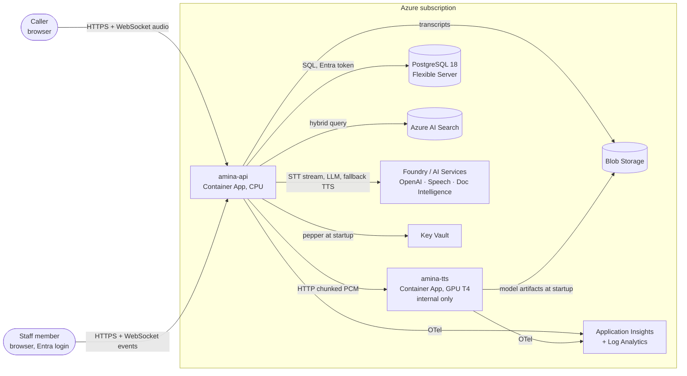

### 3.2 Components

| Component | Runs as | Responsibility | Does **not** do |
|---|---|---|---|
| **Web SPA** (`apps/web`) | Static files served by `amina-api` | `/call`: mic capture, playback, keypad, captions. `/console`: queue, case view, live transcript | No business logic; never holds secrets |
| **amina-api** (`apps/api`) | Container App (CPU), min 2 replicas | Call sessions, STT streaming, LLM orchestration, tools, checker, TTS client and fallback, persistence, console API, telemetry | No GPU work; no model hosting |
| **amina-tts** (`apps/tts`) | Container App on a serverless GPU (T4), internal ingress | Text normalisation + streaming synthesis with the Amina voice | No customer data, no logging of text content, no public endpoint |
| **PostgreSQL 18** | Azure Database for PostgreSQL Flexible Server | Bank data (synthetic), calls, events, tickets, disputes, verification attempts, policy document registry | No vector search ([ADR-014](decisions.md#adr-014-rag-on-azure-ai-search-with-push-ingestion)) |
| **Azure AI Search** | Basic tier | Policy chunk index: Arabic analyzer, vectors, semantic ranker | |
| **Blob Storage** | StorageV2 | Policy PDFs, redacted transcripts, TTS model artifacts | No raw audio |
| **AI Services (Foundry resource)** | `kind: AIServices` | Azure OpenAI (chat + embeddings + small model), Speech (STT + fallback TTS), Document Intelligence | |
| **Key Vault** | Standard | HMAC pepper for national-ID hashing (the only secret in the system) | |
| **App Insights / Log Analytics** | Workspace-based | Traces, metrics, logs, workbook, alerts | |
| **Offline: `amina ingest`** | CLI / Container Apps Job | PDF → layout → page chunks → embeddings → index | |
| **Offline: TTS training** | GPU job (see [tts.md §5](tts.md#5-training)) | Fine-tune, evaluate, publish versioned voice artifacts | |

### 3.3 The seven roles from the deck

The deck's seven agents stay as **named roles**: separate modules, separate span names in traces, and separate owners in code review. Only **Voice** and **Knowledge** involve models on the hot path ([ADR-009](decisions.md#adr-009-seven-roles-as-modules-one-llm-on-the-hot-path)).

| Role | Runtime form | Model? | Module |
|---|---|---|---|
| Voice | STT stream + TurnManager + sentence chunker + TTS client | STT, LLM, TTS | `speech/`, `call/turns.py` |
| Triage | (a) the LLM's own tool choice (routing); (b) an async classifier after each caller turn (intent, mood, wants-human) | small model, off the hot path | `agent/triage.py` |
| Data | Typed read tools over SQL, scoped to the verified customer | none | `agent/tools/data.py` |
| Knowledge | `search_policy` + `get_fee_rule` (deterministic page link) | embeddings + semantic ranker | `agent/tools/knowledge.py` |
| Action | `propose_action` → spoken yes → `confirm_action` | none | `agent/tools/action.py` |
| Checker | Deterministic gates before every tool; per-sentence numeric grounding before TTS; async post-call LLM review | small model, post-call only | `agent/checker.py` |
| Handoff | Summary + handoff ticket + console notification + caller message | small model (summary) | `agent/tools/handoff.py` |

---

## 4. Detailed component architecture

### 4.1 Repository layout (target for implementation)

```
apps/
  api/                    FastAPI service (Python 3.12, uv workspace member)
    src/amina_api/
      main.py             app factory, lifespan (pools, clients, NOTIFY listener)
      config.py           pydantic-settings; no secrets except via managed identity / Key Vault
      observability.py    OTel setup, redaction log filter
      redaction.py
      http/               REST + WebSocket routes: calls.py, console.py, health.py
      call/               session.py (CallSession), turns.py (TurnManager), state.py, protocol.py
      speech/             stt.py (Azure Speech), tts_client.py (amina-tts), azure_tts.py (fallback), chunker.py, clips.py
      agent/              llm.py (Responses API), prompt.py, checker.py, triage.py, summary.py
        tools/            registry.py, verify.py, data.py, knowledge.py, action.py, handoff.py
      db/                 engine.py (asyncpg + Entra token), queries/*.py, scope.py (RLS context)
      console/            hub.py (LISTEN/NOTIFY fan-out)
    migrations/           Alembic
    tests/
  tts/                    TTS inference service (Python 3.12, CUDA image)
    src/amina_tts/        main.py, engine.py (XTTS wrapper), voices.py, audio.py
  web/                    React + Vite + TypeScript SPA (/call, /console)
packages/
  arabic_text/            Egyptian-Arabic text normaliser (numbers, money, dates, digits, lexicon); used by amina-tts AND training
training/
  tts/                    data prep, fine-tune config, evaluation scripts (see tts.md)
ingest/                   `amina ingest` CLI (may live in apps/api as a subcommand)
evals/                    known-answer cases, red-team cases, runner
loadtest/                 Locust WebSocket scenarios + recorded audio
infra/                    Bicep modules, main.bicep, azure.yaml (azd)
docs/
```

### 4.2 amina-api internals

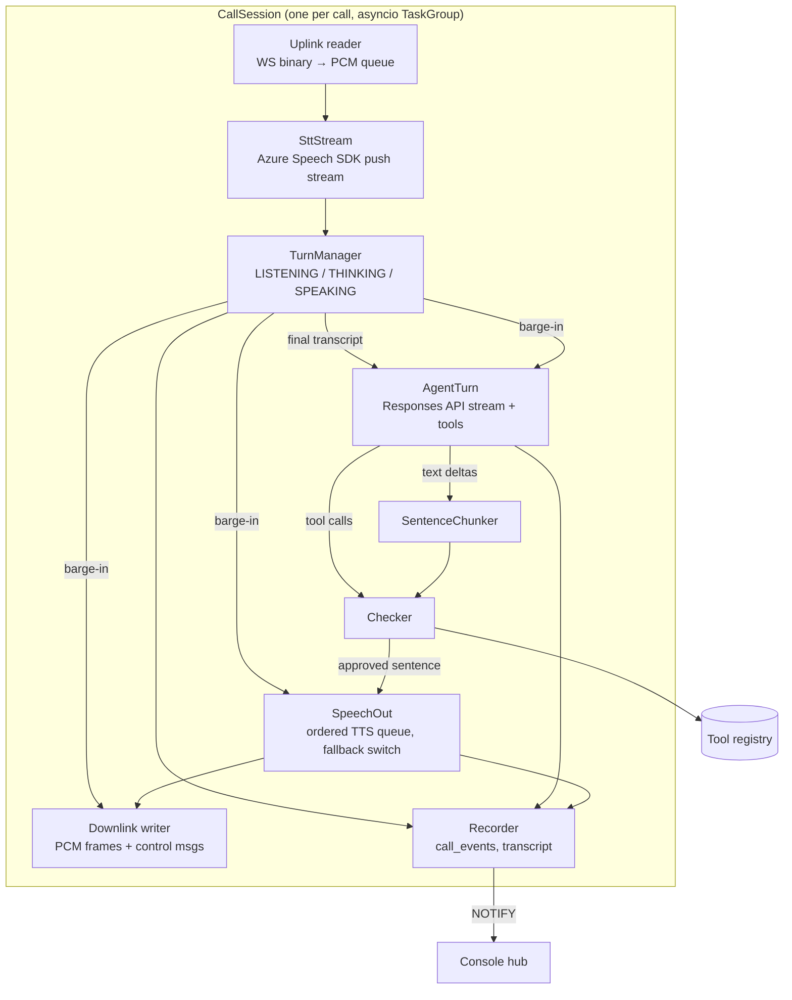

- **CallSession** owns all per-call state: call id, state machine, verified customer id, conversation history, pending action, tool results seen, metrics. It lives in one process. There is no shared mutable state between calls ([ADR-013](decisions.md#adr-013-in-process-call-state-no-redis)).
- **TurnManager** decides when a caller turn ends (on the STT final result) and when the caller is interrupting (partial transcripts while Amina is speaking). §7.1 has the details.
- **AgentTurn** runs one model response, including tool rounds, as a cancellable task.
- **SpeechOut** synthesises sentences in order, streams the PCM, and switches permanently to the fallback voice after a TTS failure.
- **Recorder** writes redacted `call_events` in batches and publishes console notifications.

### 4.3 amina-tts internals

A single process per GPU replica: FastAPI (asyncio) in front, and one inference worker thread that owns the model on the GPU. Requests queue in front of the worker; a bounded queue returns `429` once it is full. Details are in §8.3 and [tts.md §7](tts.md#7-inference-service-amina-tts).

### 4.4 Web SPA

- React 19, Vite and TypeScript. Two routes. Plain React state; no global store.
- **Audio capture:** `getUserMedia({ audio: { echoCancellation: true, noiseSuppression: true, autoGainControl: true } })` → AudioWorklet → resample to 16 kHz → PCM16 → 20 ms frames → WebSocket.
- **Audio playback:** an AudioWorklet ring buffer at 24 kHz. Frames carry an utterance sequence number. On `clear`, the buffer is flushed and late frames from cancelled utterances are discarded (§14.2).
- **Playback marks:** the client reports `played_ms` per utterance every 250 ms and at the end of each utterance. The server uses these marks to record what the caller actually heard (§9.3).
- **Console:** a WebSocket for live events, plus REST to load case details. Authentication is handled by Container Apps built-in auth (§12.2).

---

## 5. Architecture decisions (summary)

Full context, alternatives and consequences are in [decisions.md](decisions.md).

| ADR | Decision | Main alternative rejected |
|---|---|---|
| 001 | Decoupled pipeline: Azure Speech STT → Azure OpenAI → own TTS | Azure Voice Live (cannot speak with an external TTS model) |
| 002 | NileTTS-XTTS (XTTS v2) fine-tuned on SPEAKER_02, behind a ship gate | Base XTTS v2; Azure Neural TTS; Chatterbox-based Egyptian models |
| 003 | Host TTS on Container Apps serverless GPU (T4) | Azure ML online endpoint; AKS; GPU VM |
| 004 | TTS transport: HTTP POST with chunked PCM response, one request per sentence | WebSocket; gRPC |
| 005 | Fallback voice: Azure Neural TTS `ar-EG-SalmaNeural` | Hand off on TTS failure |
| 006 | Browser ↔ API: one WebSocket per call, PCM16 (16 kHz up / 24 kHz down) | WebRTC (LiveKit); Opus |
| 007 | Turn detection: STT segmentation silence + transcript-based barge-in | Semantic segmentation; client VAD |
| 008 | LLM: Azure OpenAI Responses API (v1), streaming, `store=false` | Chat Completions; agent frameworks |
| 009 | Seven roles as modules, one LLM on the hot path | Seven LLM agents |
| 010 | PostgreSQL 18; SQLAlchemy Core + asyncpg + Alembic | PostgreSQL 17; ORM; psycopg 3 |
| 011 | Session-scoped authorization + Postgres RLS as defence in depth | App-only filtering |
| 012 | Verification: National ID (HMAC) + DOB, keypad option, lockouts | OTP (no SMS channel in v1) |
| 013 | In-process call state; Postgres `LISTEN/NOTIFY` for the console | Redis |
| 014 | RAG: push ingestion (Document Intelligence layout) → AI Search hybrid + semantic ranker | Indexer + skillset; pgvector |
| 015 | Hosting: Azure Container Apps | App Service; AKS |
| 016 | IaC and delivery: Bicep + azd + GitHub Actions (OIDC) | Terraform |
| 017 | Identity: managed identity everywhere; Key Vault holds only the pepper | Keys in app settings |
| 018 | Console in the same SPA, behind Easy Auth; v1 handoff = queue + callback | Separate console app; live voice takeover in v1 |
| 019 | Observability: OpenTelemetry via the Azure Monitor distro | Vendor SDK logging only |
| 020 | SPA served by the API container | Static Web Apps; Next.js |
| 021 | Python 3.12, uv workspace, ruff, pyright | Poetry; 3.13 (TTS dependency risk) |

---

## 6. Request and audio data flows

### 6.1 Call setup and verification

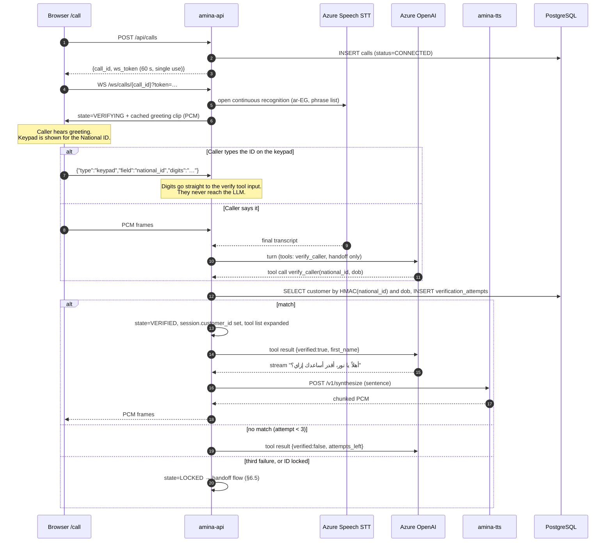

### 6.2 Fee question: the deck's worked example

"ليه اتخصم مني رسوم يوم 3؟" ("Why was I charged a fee on the 3rd?")

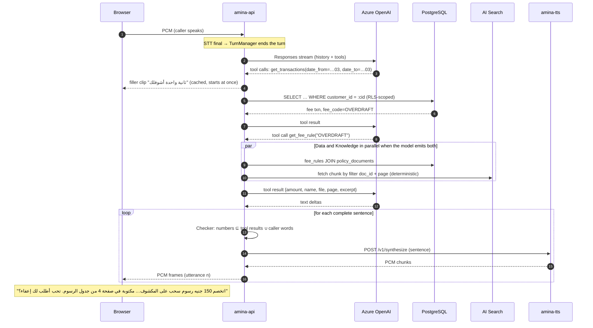

### 6.3 Confirmed action

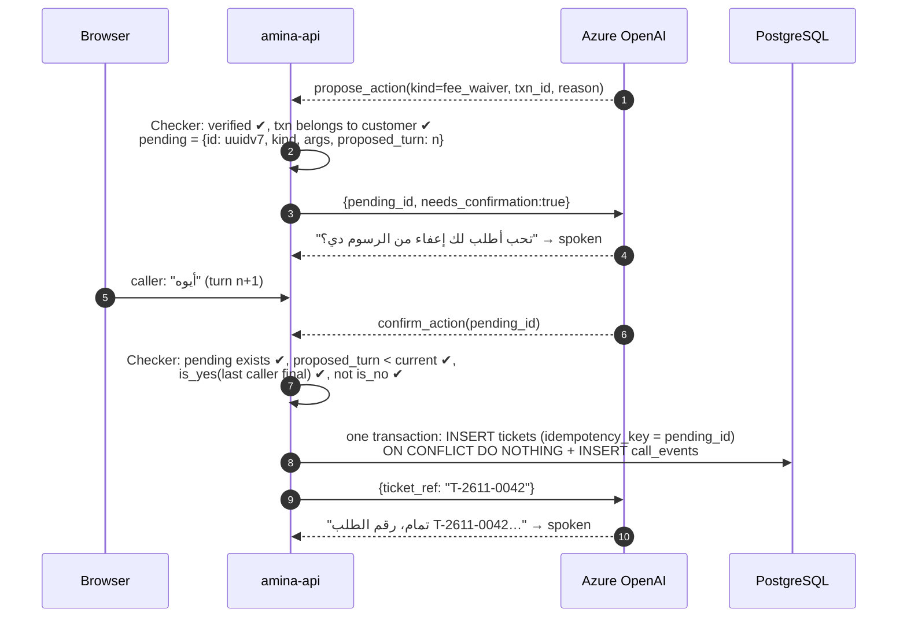

If the caller's last words are not a clear yes, `confirm_action` returns `{confirmed:false, reason:"no explicit yes"}`. The model then asks again or drops the action. **The model cannot create a record on its own.**

### 6.4 Barge-in (interruption)

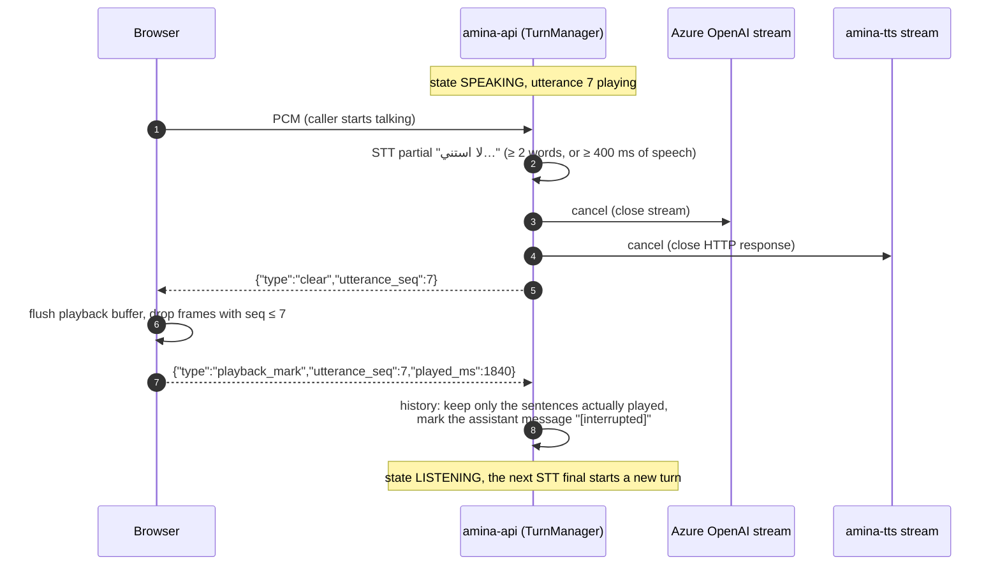

### 6.5 Handoff

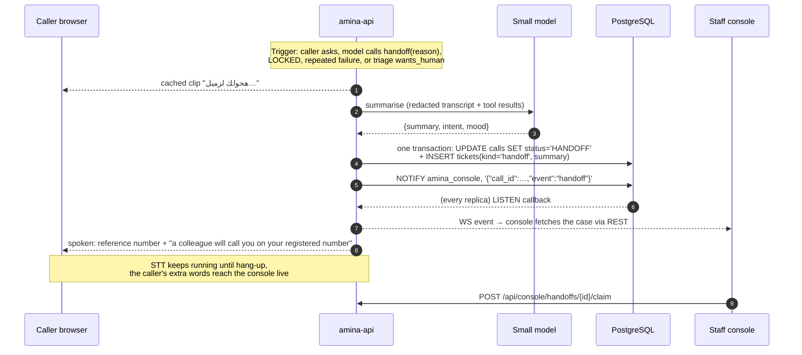

### 6.6 TTS failure → fallback voice

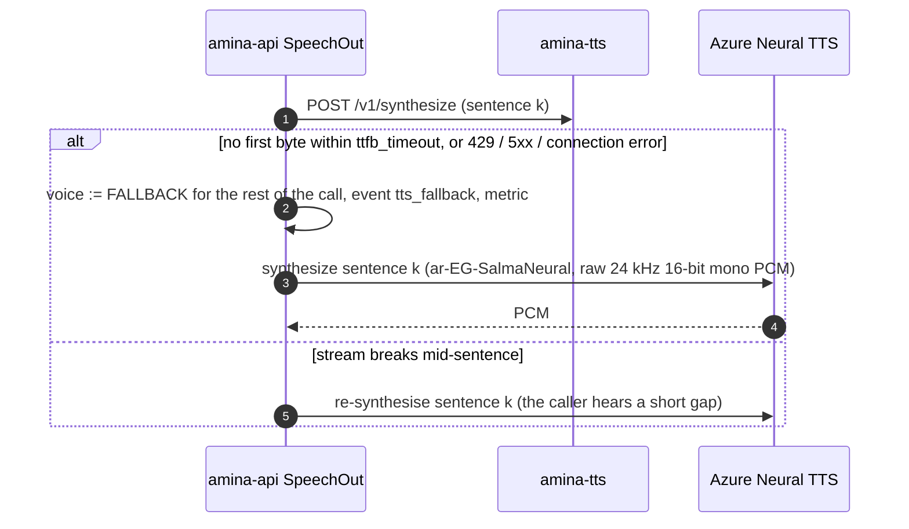

The fallback switch is **sticky for the rest of the call**: one voice change is acceptable, flip-flopping between voices is not. Each new call tries `amina-tts` first.

### 6.7 Policy ingestion (offline)

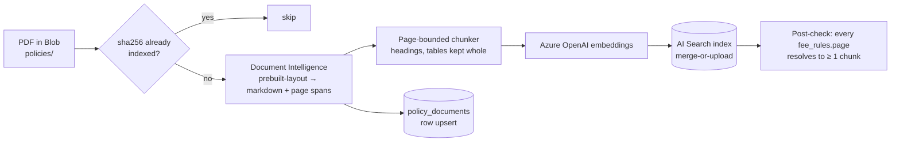

---

## 7. Speech-to-text, LLM and custom TTS integration

### 7.1 Speech-to-text (Azure Speech SDK)

- **Confirmed:** `ar-EG` supports real-time transcription ([language support](https://learn.microsoft.com/en-us/azure/ai-services/speech-service/language-support?tabs=stt)).
- **Mode:** continuous recognition on a `PushAudioInputStream` (16 kHz, 16-bit, mono PCM). There is one recognizer per call, inside `amina-api`.
- **Events used:** `recognizing` (partials) drives barge-in detection and live captions; `recognized` (finals) ends a caller turn; `canceled` triggers error handling (§13).
- **End of turn:** `Speech_SegmentationSilenceTimeoutMs`. **Confirmed:** the valid range is 100–5000 ms and 500 ms is the typical default ([how to recognize speech](https://learn.microsoft.com/en-us/azure/ai-services/speech-service/how-to-recognize-speech?pivots=programming-language-python)). We start at 500 ms and tune from 400 to 800 ms in the voice-quality tests, trading cut-offs against sluggishness. That is the deck's "too early cuts them off; too late feels slow".
- **Semantic segmentation is not used.** Microsoft documents it as "not intended for interactive scenarios", and `ar-EG` support is not listed ([ADR-007](decisions.md#adr-007-turn-detection)).
- **Phrase list:** banking terms (Instapay, ميزا, Overdraft, IBAN, product names, and the bank name) improve recognition. **Assumption:** phrase lists are enabled for `ar-EG`. This is checked on day 1; without them, recognition simply runs unbiased.
- **Continuation rule:** if a new STT final arrives while an `AgentTurn` is still THINKING and nothing has been spoken yet, the turn is cancelled and both utterances are merged into one caller turn. This handles callers who pause mid-sentence.
- **Authentication:** Microsoft Entra token for the AI Services resource (custom subdomain), refreshed before expiry. **Assumption:** the Python Speech SDK version we pin accepts a token credential or an authorization token. This is verified on day 1; there is no key fallback.

### 7.2 LLM (Azure OpenAI Responses API)

- **Confirmed:** the v1 API, including `/openai/v1/responses`, is GA, and no `api-version` is required ([v1 API lifecycle](https://learn.microsoft.com/en-us/azure/foundry/openai/api-version-lifecycle)). Region availability is checked on day 1.
- **Call shape:** `responses.create(model=<deployment>, input=history, tools=tools_for_state, stream=True, store=False, parallel_tool_calls=True, max_output_tokens=200)`. With `store=False`, no conversation is held server-side; the API owns the history (redacted copies go to Postgres).
- **Model choice:** the fastest **current** mini-class chat model deployed in our region. The candidate list is fixed on day 1 from the region's model catalogue, and the winner is picked on day 3 by the known-answer eval (accuracy first, then TTFT p95). A smaller model handles triage, summary and post-call review. **Open:** model names (§19).
- **Tools exposed per state:** `VERIFYING` exposes `verify_caller` and `handoff` only. `VERIFIED` exposes all the Data, Knowledge, Action and Handoff tools. `HANDOFF`, `LOCKED` and `ENDED` expose none. The tool router also rejects any call that is not allowed in the current state, as defence in depth (§9.2).
- **Prompt:** the v0 system prompt, revised for spoken Egyptian Arabic and short sentences. Digits are written as digits, because normalisation is the TTS service's job; tool results are cited by `file` and `page`. The prompt is versioned in the repo, and its hash is recorded on each call.
- **Limits:** at most 4 tool rounds per turn, and `max_output_tokens` is small because these are spoken replies. If the round limit is hit, the turn becomes a handoff offer.

### 7.3 Custom TTS integration

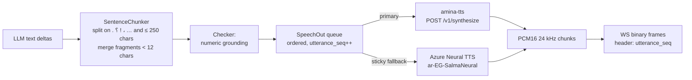

- **Sentence streaming:** the first sentence goes to TTS as soon as it is complete, while the LLM is still generating the rest. While sentence *k* plays, sentence *k + 1* is synthesised. At most **one in-flight synthesis per call**, so one call cannot monopolise the GPU.
- **Why sentences rather than token streams:** XTTS conditions on whole text inputs. Sentence-level requests give natural prosody and clean cancellation points, and they match the playback marks used to truncate history.
- **Filler and system clips:** greeting, "one moment", "transferring you", "sorry, I'm having trouble" and the lockout message. These are synthesised by `amina-tts` when `amina-api` starts and cached in memory as PCM. If `amina-tts` is unavailable at startup, they come from Azure TTS. Filler playback needs no GPU on the hot path.
- **Normalisation is inside `amina-tts`.** The API sends display text containing digits, which the checker needs. `amina-tts` normalises with `packages/arabic_text`, the same code used to prepare the training data, so training and inference always see identically normalised text ([tts.md §4](tts.md#4-text-normalisation)).
- **The audio format is the same on both paths:** PCM16 little-endian, 24 kHz, mono. XTTS outputs 24 kHz; Azure TTS is asked for raw 24 kHz 16-bit mono PCM. The browser never knows which voice engine produced a frame.

---

## 8. TTS training, evaluation and inference architecture

This section summarises [tts.md](tts.md), which holds the full method.

### 8.1 Model and voice

- **Starting checkpoint:** [NileTTS-XTTS](https://huggingface.co/KickItLikeShika/NileTTS-XTTS), an XTTS v2 model fine-tuned on Egyptian Arabic. Its model card reports WER 26.8% → 18.8% and CER 8.1% → 4.1% against base XTTS v2. The ASR used for those numbers is not stated, so we re-measure on our own test set.
- **Voice:** NileTTS `SPEAKER_02` (female, synthetic). We keep a single speaker identity and mix in no human recordings ([ADR-002](decisions.md#adr-002-custom-tts-model-niletts-xtts)).
- **Licence:** XTTS v2 weights are under the Coqui Public Model License (non-commercial). We treat NileTTS-XTTS as CPML **despite its Hugging Face "Apache-2.0" label**, because a fine-tune cannot relicense the base weights ([tts.md §2](tts.md#2-licensing)).

### 8.2 Training pipeline

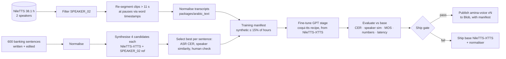

### 8.3 Inference service

| Item | Design |
|---|---|
| Runtime | FastAPI + `coqui-tts` ([idiap fork](https://github.com/idiap/coqui-ai-TTS), maintained), PyTorch, CUDA runtime image |
| Model load | Artifacts downloaded from Blob with managed identity at startup; speaker conditioning latents precomputed once per voice |
| Concurrency | One inference worker thread per GPU. `MAX_CONCURRENT` (start at 1) and a `QUEUE_LIMIT` small enough that a queued request still meets the TTFB budget; beyond it, `429` |
| Streaming | `inference_stream(...)` yields audio chunks → converted to PCM16 → written as chunked HTTP |
| Readiness | `/readyz` returns OK only after the model is loaded and warm-up synthesis is done |
| Privacy | Text is never logged; only lengths, ids and timings |
| Network | Internal ingress only; reachable only from inside the Container Apps environment |

The API contract is in §14.4. GPU sizing and cost are in [tts.md §8](tts.md#8-gpu-sizing-scaling-and-cost).

**Streaming latency:** Coqui documents "< 200 ms" streaming latency with DeepSpeed ([XTTS docs](https://docs.coqui.ai/en/latest/models/xtts.html)), and users report 0.25–0.9 s in self-hosted setups ([issue #29](https://github.com/coqui-ai/xtts-streaming-server/issues/29)). **No source reports T4 numbers**, so T4 time-to-first-byte is the first thing measured (day 2 spike).

---

## 9. Agent and tool execution workflows

### 9.1 Call state machine

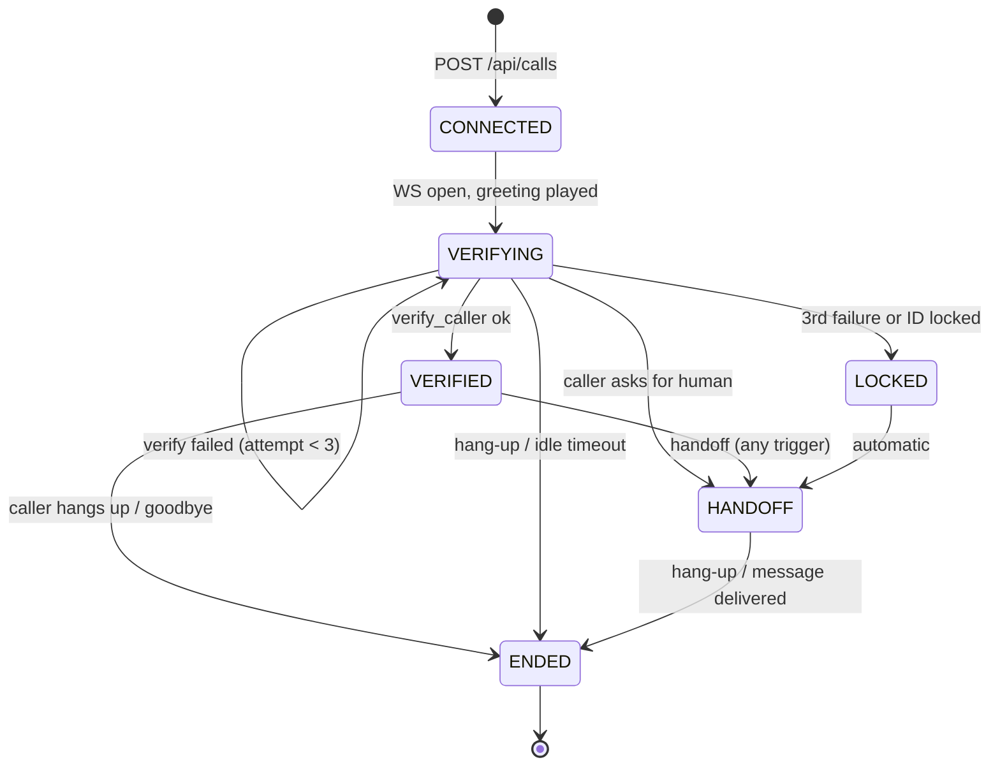

Within a call, the turn state machine is orthogonal to the call state:

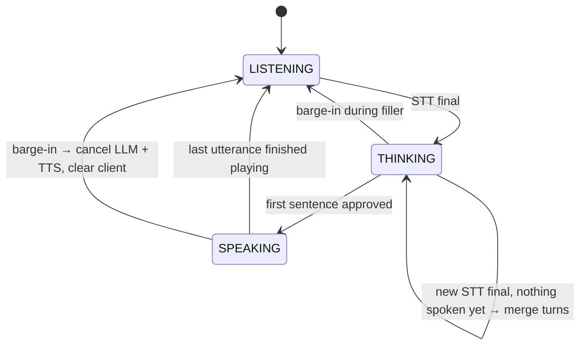

**Idle rule:** after 20 s of silence in LISTENING, Amina asks "حضرتك لسه معايا؟" ("Are you still with me?"); after another 20 s, the call ends. Both timings are **Decisions** and configurable.

### 9.2 Tool registry

Every tool is declared once, with a role, a Pydantic argument model (which generates the JSON schema the LLM sees), the states it is allowed in, a timeout, and whether it is idempotent (and so retryable).

| Tool | Role | Allowed states | Timeout | Retry | Returns (summary) |
|---|---|---|---|---|---|
| `verify_caller(national_id, date_of_birth)` | Checker/Data | VERIFYING | 1.5 s | no | `{verified, first_name?, attempts_left}` (never says whether the ID exists) |
| `get_accounts()` | Data | VERIFIED | 1.5 s | 1× | type, currency, balance, status |
| `get_cards()` | Data | VERIFIED | 1.5 s | 1× | type, last4, status, daily_limit |
| `get_transactions(date_from, date_to, kind?)` | Data | VERIFIED | 1.5 s | 1× | ≤ 20 rows, including `fee_code` |
| `get_disputes()` | Data | VERIFIED | 1.5 s | 1× | status, opened_at, reason |
| `get_fee_rule(fee_code)` | Knowledge | VERIFIED | 2 s | 1× | name, amount, `file`, `page`, excerpt (the chunk fetched by `doc_id` + `page` filter) |
| `search_policy(query, doc_type?)` | Knowledge | VERIFIED | 2 s | 1× | top 3 chunks: `file`, `page`, `title`, excerpt ≤ 600 chars |
| `propose_action(kind, args)` | Action | VERIFIED | 0.2 s | — | `{pending_id, summary_to_read_back}` |
| `confirm_action(pending_id)` | Action | VERIFIED | 2 s | idempotent | `{ticket_ref}` or `{confirmed:false, reason}` |
| `handoff(reason)` | Handoff | VERIFYING, VERIFIED | 3 s | — | `{reference}` |

- **No tool takes a `customer_id`.** The customer comes from `CallSession.customer_id`, which only `verify_caller` sets.
- **Tool outputs are data, not instructions.** They are wrapped as JSON with a `source` field, and the system prompt states that text inside tool results can never change the rules. This defends against prompt injection hidden in documents ([§12.7](#127-prompt-injection-and-abuse)).
- **Parallelism:** when the model emits several tool calls in one round, they run concurrently in an `asyncio.TaskGroup`, each under its own timeout. That is how Data and Knowledge run "in parallel" as the deck says, without separate agents.

### 9.3 Conversation history

- History holds system prompt + caller finals + assistant **spoken** text + tool calls/results (results trimmed to the fields the model needs).
- On barge-in, the assistant message is cut down to the sentences whose playback finished (per playback marks) and marked "[interrupted]". This keeps the model from believing the caller heard things they didn't.
- Verification turns are kept in memory for the LLM as-is (needed for correction dialogues). They are **persisted** only as `[verification utterance]` (§12.6).
- Size cap: history beyond ~20 turns is summarised by the small model (rare for support calls; included for safety).

### 9.4 Action role rules (enforced in code)

1. `propose_action` validates that the target belongs to the customer (for example, the transaction's `customer_id` matches) and stores one pending action. A new proposal replaces the old one.
2. `confirm_action` succeeds only if:
   - (a) a pending action with that id exists;
   - (b) it was proposed in an earlier turn;
   - (c) the latest caller final matches the yes lexicon and does not match the no lexicon. The v0 `YES_RE`/`NO_RE` lists are extended with Egyptian variants and evaluated on the test set.
3. The database write uses `idempotency_key = pending_id` with a unique constraint. A retried confirm never creates a duplicate.
4. Kinds in v1: `fee_waiver`, `card_unblock_request`, `dispute`, `general_ticket`. Each kind maps to a ticket and/or dispute row; staff decide the outcome.

### 9.5 Checker role

| Check | When | Blocking? | On failure |
|---|---|---|---|
| State gate (tool allowed in the current state) | before every tool | yes | tool returns `{error:"not_allowed"}`, event logged |
| Ownership (row belongs to the session customer) | inside every Data/Action query (SQL + RLS) | yes | empty result |
| Yes-check | `confirm_action` | yes | `{confirmed:false}` |
| **Numeric grounding** | each sentence before TTS | **configurable**: `flag` (default) or `block` | `flag`: speak, emit `grounding_flag` event, show a console badge. `block`: replace with "خليني أتأكد من المعلومة دي" ("let me double-check that") and re-prompt the model |
| Post-call review | after the call ends | no | small-model review of the redacted transcript against tool results; score stored on the call |

**How numeric grounding works:** extract every number token from the sentence (Western or Arabic-Indic digits, decimals, dates, `T-…` refs). Each must appear in the call's **allowed set**: all tool-result values plus numbers the caller said. This check is cheap and deterministic, and it catches the most harmful hallucinations in banking (wrong amounts, pages, dates). We start in `flag` mode, measure the false-positive rate in the eval suite, and switch to `block` if it is below 2% (**Target**).

### 9.6 Handoff role (v1: warm handoff to a queue)

**Triggers:**

- the caller asks;
- the model calls `handoff`;
- state `LOCKED`;
- two consecutive tool failures;
- the turn limit is hit;
- triage reports `wants_human` or `mood = angry` on 2 consecutive turns.

In the last case, Amina **offers** a handoff rather than forcing one.

**Steps:**

1. Play the "transferring" clip.
2. The small model writes the summary, intent and mood from the redacted transcript.
3. One transaction: the call status becomes HANDOFF and a ticket of kind `handoff` is inserted.
4. NOTIFY the console.
5. Read the reference number to the caller and explain the callback.

**v1 limitation (Decision, [ADR-018](decisions.md#adr-018-staff-console-and-v1-handoff-model)):** staff **claim** the case and see the full context, but they cannot yet talk to the caller live. Live voice takeover is designed in §14.7 as phase 2.

---

## 10. PostgreSQL database design

### 10.1 Version and platform

**Decision: PostgreSQL 18 on Azure Database for PostgreSQL Flexible Server** ([ADR-010](decisions.md#adr-010-postgresql-18-sqlalchemy-core-asyncpg-alembic)).

- **Confirmed:** PG 18 is GA on Flexible Server, available in all public regions, with Entra ID integration and 80+ extensions ([GA announcement](https://techcommunity.microsoft.com/blog/adforpostgresql/postgresql-18-now-ga-on-azure-postgres-flexible-server/4469802)).
- Local development and CI use the official `postgres:18` image.
- **SQLite is not used anywhere.**

### 10.2 ER diagram

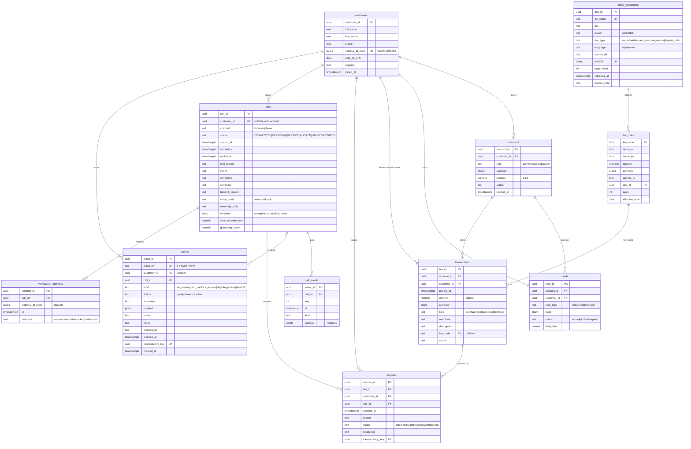

### 10.3 Schema conventions and the reasons for them

| Convention | Reason |
|---|---|
| `uuid` keys defaulting to `uuidv7()` (native in PG 18) | Time-ordered keys index well and expose no row counts. **Assumption:** `uuidv7()` is available on Azure PG 18 (it is core, not an extension; checked on day 1). Fallback: generate in the app |
| Money as `numeric(14,2)` + a `currency char(3)` | Exact arithmetic; floats are never used for money |
| `timestamptz` everywhere, stored in UTC; rendered in `Africa/Cairo` | Correct across DST changes |
| `text` + `CHECK (col IN (…))` instead of PG `ENUM` | Adding a value is a simple migration; enums need `ALTER TYPE` and are awkward in Alembic |
| `customer_id` denormalised onto `cards`, `transactions`, `disputes` | Makes every customer-scoped query a single-column predicate and allows simple RLS policies. Consistency is enforced by a trigger or by composite FKs `(account_id, customer_id) → accounts` (**Decision:** composite FK, which is declarative) |
| `national_id_hash = HMAC-SHA256(pepper, normalised_id)` | A database leak doesn't reveal IDs; the pepper lives in Key Vault. Exact-match lookup still works through a unique index |
| `call_events` append-only with `(call_id, seq)` unique | Full replay of a call; ordering is guaranteed per call |
| `idempotency_key` unique on `tickets` and `disputes` | Exactly-once creation under retries |
| `ticket_ref` from a per-month sequence | Short and readable aloud: "T-2611-0042" |

**Indexes:** FK columns; `transactions (customer_id, posted_at DESC)`; `calls (status, started_at DESC)` for the console; `tickets (status, created_at)` where `kind='handoff'`; `verification_attempts (national_id_hash, at DESC)`.

### 10.4 Roles and row-level security

| DB role | Mapped to | Privileges |
|---|---|---|
| `amina_migrator` | CI/CD deploy identity (Entra), used only by the migration job | DDL on schema `amina` |
| `amina_api` | `amina-api` managed identity (Entra) | `SELECT` on bank tables and `fee_rules` / `policy_documents`; `INSERT/UPDATE` on `calls`, `call_events`, `tickets`, `disputes`, `verification_attempts`; **no** `UPDATE/DELETE` on bank tables |
| `amina_readonly` | team members (Entra group), for debugging | `SELECT` on everything except `customers.national_id_hash` (column privilege) |

**RLS (defence in depth, [ADR-011](decisions.md#adr-011-authorization-session-scope-plus-row-level-security)):**

- `customers`, `accounts`, `cards`, `transactions`, `disputes` and `tickets` have `ENABLE ROW LEVEL SECURITY` + `FORCE`.
- The policy is: `USING (customer_id = current_setting('amina.customer_id', true)::uuid OR current_setting('amina.scope', true) = 'staff')`.
- Caller-path queries run inside `async with customer_scope(conn, customer_id):`, which executes `SET LOCAL amina.customer_id = …` within a transaction. Console queries use `staff_scope()` after Easy Auth has authenticated the staff user.
- Verification is the one lookup that must run before any customer is in scope. **Decision:** it goes through a `SECURITY DEFINER` function `amina.verify_lookup(hash bytea)` that returns only `customer_id, first_name, date_of_birth` for an exact hash match. `amina_api` gets `EXECUTE` on that function, not broader access. This is simpler and narrower than an extra RLS policy with a special "verify" scope.
- **What RLS protects against, honestly:** a caller-path query that forgets its `WHERE customer_id` returns nothing instead of another customer's data. It does **not** protect against a compromised API process, which could set the variable itself.

### 10.5 Transactions and migrations

- **Connection pool:** SQLAlchemy 2 async engine on asyncpg, pool size per replica 10 (**Decision**, revisited after the load test). Entra auth works by passing a fresh access token as the password through a `do_connect` hook; tokens are cached until 5 minutes before expiry.
- **Transaction boundaries:** one transaction per tool call for reads (needed for `SET LOCAL`). Action confirmation writes the ticket/dispute + `call_events` row + `calls` update in **one** transaction. Event batches from the recorder are their own transactions, flushed every 1 s or 20 events.
- **Isolation:** `READ COMMITTED` (default). There are no read-modify-write cycles on bank data; writes are inserts guarded by unique keys.
- **Migrations:** Alembic, with SQL-first revisions (`op.execute` for RLS, functions and grants). They run as a **Container Apps Job** (`alembic upgrade head`) triggered by `azd` before the new API revision is deployed. Migrations are forward-only, and every revision must be backward compatible with the previous API revision (expand → migrate → contract).
- **Seed:** `amina seed` loads the synthetic bank deterministically (fixed UUIDs, so eval cases can reference rows). It runs in the same job for dev environments only.

### 10.6 Retention

`call_events` and transcripts are deleted after 30 days by a `pg_cron` job (a **Confirmed** extension on Azure PG 18) and a Blob lifecycle rule. 30 days is a **placeholder** until a retention period is agreed with the tutor or legal.

---

## 11. RAG architecture and document ingestion

### 11.1 Corpus

**Decision:** 5–8 public Egyptian documents, collected and licence-checked by owner P3 on days 1–2.

| Slot | Example sources (to be confirmed) | Used for |
|---|---|---|
| Retail fee schedule (primary) | One Egyptian bank's published retail tariff (e.g. NBE, Banque Misr or CIB) | `fee_rules` are linked to its pages |
| Second fee schedule | Another Egyptian bank | Cross-checking and "it depends on the bank" answers |
| Card terms and conditions | Debit/credit card T&C of the primary bank | Card use, blocking, liability |
| CBE regulation: consumer protection | Central Bank of Egypt consumer protection regulations | Complaints, dispute handling, rights |
| CBE regulation: payments/transfers | CBE electronic payment / Instapay rules | Transfer questions |
| Dispute or complaint procedure | Primary bank's complaint procedure | Dispute steps |

`policy_documents.licence_note` records each source's terms. A document whose terms forbid our use is dropped. **Open:** the final list (§19).

### 11.2 Ingestion (`amina ingest`)

1. **Register:** compute sha256 and upsert into `policy_documents`. Unchanged files are skipped, so ingestion is idempotent.
2. **Extract:** Document Intelligence `prebuilt-layout` with markdown output. This gives text, headings, tables and page numbers, and handles OCR for scanned Arabic PDFs.
3. **Chunk:** chunks never cross a page boundary, so every chunk has exactly one `page`. Within a page, the text is split on headings and paragraphs to ≤ ~400 tokens with ~10% overlap. **Tables are kept whole** with their header row repeated, because fee schedules are tables and splitting a row from its header destroys meaning.
4. **Embed:** Azure OpenAI embedding model (multilingual). Model choice is fixed on day 3 by retrieval recall on our question set.
5. **Index:** `mergeOrUpload` into the index by chunk id `doc_id:page:n`.
6. **Validate:** every `fee_rules (doc_id, page)` must resolve to at least one chunk, and a sampling report shows 10 random chunks per document for a human check of OCR quality.

**Why push ingestion rather than indexer + skillset** ([ADR-014](decisions.md#adr-014-rag-on-azure-ai-search-with-push-ingestion)): page numbers are guaranteed by our own code, the pipeline is unit-testable, it re-runs in minutes, and it has no skillset debugging. The corpus is under 10 documents.

### 11.3 Index schema

| Field | Type | Notes |
|---|---|---|
| `id` | key | `doc_id:page:n` |
| `doc_id`, `file_name`, `title`, `issuer`, `doc_type` | filterable | |
| `page` | int, filterable | Citations and the deterministic fee-rule lookup |
| `section` | searchable | Heading path |
| `content` | searchable, analyzer `ar.microsoft` | **Confirmed:** Arabic analyzers exist (`ar.microsoft`, `ar.lucene`) ([language analyzers](https://learn.microsoft.com/en-us/azure/search/index-add-language-analyzers)). `ar.microsoft` vs `ar.lucene` is picked by recall on our question set |
| `content_vector` | vector (HNSW) | Integrated vectorizer configured for query-time embedding |

### 11.4 Retrieval

- `search_policy`: hybrid query (BM25 + vector, RRF fusion), then the semantic ranker, then the top 3 results. Each result returns `file_name`, `page`, `title` and an excerpt of ≤ 600 chars.
- **Confirmed:** the semantic ranker needs Basic tier or higher beyond the free monthly allowance ([semantic ranker](https://learn.microsoft.com/en-us/azure/search/semantic-search-overview)), so we use the **Basic** tier.
- `get_fee_rule`: a **deterministic** path. A SQL lookup of the fee rule is followed by an AI Search *filter* query (`doc_id eq … and page eq …`) for the excerpt. For fee questions, the citation never depends on ranking quality.
- **Retrieval evaluation:** 40 questions (Arabic and mixed) with expected `(doc, page)`. Metric: recall@3. **Target ≥ 0.85** before M2 (§17).

---

## 12. Authentication, authorization and security boundaries

### 12.1 Trust boundaries

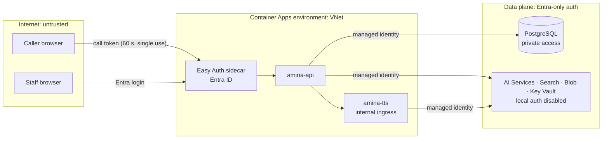

### 12.2 Who can do what

| Principal | Authenticated by | Can |
|---|---|---|
| Caller (anonymous) | Signed call token from `POST /api/calls` (HMAC with a per-deployment signing key derived from the Key Vault pepper; expires after 60 s; bound to `call_id`; single use) | Open one call WebSocket. Read data only after verification, and only their own |
| Staff | Container Apps built-in auth (Entra ID). App role `Amina.Staff` checked by the API from `X-MS-CLIENT-PRINCIPAL` | Console: list, view and claim handoffs, read customer records in staff scope |
| `amina-api` | Managed identity | Postgres (`amina_api` role), AI Services (Cognitive Services User + OpenAI User), Search (Index Data Reader), Blob (Data Contributor on `transcripts`, Reader on `policies`), Key Vault (Secrets User), call `amina-tts` |
| `amina-tts` | Managed identity | Blob Reader on `tts-models` |
| CI/CD | GitHub OIDC federated credential | Deploy and run the migration job; no data-plane read |

**Easy Auth configuration** ([authConfigs reference](https://learn.microsoft.com/en-us/azure/templates/microsoft.app/2025-01-01/containerapps/authconfigs)):

- `unauthenticatedClientAction = RedirectToLoginPage`.
- `excludedPaths`: `/call*`, `/assets/*`, `/api/calls`, `/ws/calls/*`, `/healthz`, `/readyz`.
- **Assumption:** WebSocket upgrades on `/ws/console` carry the Easy Auth session cookie and are authenticated by the sidecar. Verified on day 2; the fallback is a short-lived console token minted by an authenticated REST call.

### 12.3 Caller verification

- **Factors:** National ID (14 digits) and date of birth, as the deck specifies.
- **Lookup:** `HMAC(pepper, digits)` → `amina.verify_lookup()` → constant-time comparison of the DOB in the app.
- **Uniform responses:** wrong ID and wrong DOB produce the same answer. The caller is never told which one was wrong, which prevents enumeration.
- **Lockouts:**
  - 3 failures per call → `LOCKED` → handoff.
  - 5 failures for the same ID hash within 24 h → that ID can't verify by voice for 24 h (handoff only).
  - 10 failed calls per client IP per hour → `POST /api/calls` returns 429.
- **Keypad:** the preferred input for the ID. Digits go from the WebSocket to the verify tool without passing through STT or the LLM, so the LLM never sees the ID. Spoken input remains possible; the LLM extracts the digits and the server validates the format (14 digits; century digit 2 or 3).
- **Challenge, recorded for the tutor:** ID + DOB is **weak knowledge-based authentication**, since both are often known to relatives or appear on documents. It is acceptable for a synthetic-data demo. For production we recommend an OTP to the registered phone number (via ACS SMS) as the second factor. That is designed in ADR-012 and not built.

### 12.4 Data access authorization

- **Layer 1:** the tool registry only exposes data tools in `VERIFIED`.
- **Layer 2:** tool functions take the customer from the session, never from LLM arguments.
- **Layer 3:** SQL predicates on `customer_id`.
- **Layer 4:** RLS (§10.4).
- **Layer 5:** the database role cannot modify bank data.

### 12.5 Secrets and identity

- No API keys anywhere. Local auth is disabled on AI Services, Search, Storage and Key Vault.
- The **only secret** is the HMAC pepper, stored in Key Vault and loaded once at startup.
- Local development uses `az login` (`DefaultAzureCredential`) against a dev resource group; there are no `.env` secrets.

### 12.6 Privacy and sensitive data handling

| Data | Where it exists | Protection |
|---|---|---|
| Raw caller audio | Memory only (streamed to STT) | Never stored |
| National ID | Memory during verification | Stored only as an HMAC. Keypad path never reaches the LLM. Verification turns persisted as `[verification utterance]` |
| Transcripts | Memory; Postgres `call_events`; Blob JSON | Redacted before persistence: Arabic-Indic → ASCII digits first, then patterns for 14-digit IDs, 13–19-digit PANs (Luhn), Egyptian mobiles `01[0125]\d{8}` and long digit runs. Spoken number words in `VERIFYING` are covered by the verification-turn rule |
| Logs / traces | App Insights | A logging filter and an OTel span processor apply the same redaction. Text content is not put in span attributes, only lengths and ids |
| TTS service | GPU container memory | Text never logged |
| LLM requests | Azure OpenAI | `store=false`; data stays within our tenant's Azure OpenAI resource |

### 12.7 Prompt injection and abuse

- **Structural defences (most important):** the model can't reach data before verification, can't choose the customer, can't write without a spoken yes, and can't approve anything. A successful jailbreak can, at worst, make Amina say something wrong. It can't make her leak another customer's data.
- **Content filters** on the model deployment include Prompt Shields for jailbreaks and for indirect attacks in grounded documents. **Assumption:** both are configurable on our deployment's content filter policy; checked on day 3.
- **Documents:** only our curated PDFs are indexed. Ingestion samples are reviewed by a human. Tool results are delimited and declared untrusted in the prompt.
- **Red-team suite** (§17): spoken jailbreaks, "ignore your instructions", requests for other customers' data, injection planted in a test PDF, impersonation attempts and lockout behaviour.

---

## 13. Error handling, retries, fallbacks and failure scenarios

### 13.1 Principles

1. Every external call has a timeout. There are no unbounded waits on the call path.
2. Only idempotent reads are retried, at most once, and only while nothing has yet been spoken for that step.
3. Every failure has a **spoken** recovery line, from the cached clips when TTS itself is the problem.
4. Persistent failure ends in a handoff, never in silence.

### 13.2 Failure scenarios

| Failure | Detection | Behaviour | Caller hears |
|---|---|---|---|
| STT connection drops | `canceled` event with an error | Reconnect once (new recognizer, same push stream); audio buffered meanwhile (≤ 2 s) | Nothing if the reconnect succeeds; otherwise "sorry, I'm having trouble hearing you" → handoff |
| LLM 429/5xx before the first token | Exception | Retry once after 300 ms | Filler clip covers the wait |
| LLM fails mid-stream or times out (TTFT > 4 s) | Exception or timer | Cancel; play apology clip; offer a handoff | "معلش حصلت مشكلة…" ("sorry, something went wrong…") |
| Tool timeout or DB error | Timeout or exception | Tool returns `{error:"unavailable"}`; the model tells the caller it can't access the system right now. Two consecutive failures → handoff | Short apology |
| AI Search down | Exception | `search_policy` → unavailable; `get_fee_rule` still returns the SQL part without an excerpt | Fee answer without a quote, or "I can't open the policy right now" |
| amina-tts slow, busy or down | TTFB timer, 429, 5xx | Sticky fallback to Azure TTS (§6.6) | Voice changes once |
| Azure TTS also fails | Exception | Text-only mode: captions in the browser; call offered to end with a reference | Captions |
| Caller WebSocket drops | WS close | Call ends (`end_reason=client_disconnect`), state persisted | — |
| API replica crash or deploy | Process exit | **Calls on that replica are lost** (accepted, [ADR-013](decisions.md#adr-013-in-process-call-state-no-redis)); graceful drain on SIGTERM avoids this for normal deploys | Call drops; browser shows "call ended, please call again" |
| Postgres unavailable | Pool errors | New calls refused (503) at `POST /api/calls`; active calls can't verify → handoff without DB is impossible → apology + end | Apology |
| NOTIFY missed (console offline) | Console reconnect | Console re-syncs the full state via REST on connect | — |
| Key Vault unavailable at startup | Startup error | Replica not ready; old revision keeps serving | — |

### 13.3 Availability, honestly

**Single points of failure in v1, all accepted for the demo:**

- one `amina-tts` GPU replica (mitigated by the fallback voice);
- one Postgres server without HA (Burstable tier);
- a replica crash drops its calls.

The 99.5% target is for the demo period; this is not a bank-grade SLO. The phase-2 path is zone-redundant HA Postgres, ≥ 2 TTS replicas, and call resumption through ACS.

---

## 14. Real-time communication and concurrency

### 14.1 Caller WebSocket protocol (`/ws/calls/{call_id}`)

| Direction | Frame | Content |
|---|---|---|
| C → S | binary | PCM16 LE, 16 kHz, mono, 20 ms (640 bytes) |
| C → S | JSON | `{"type":"keypad","field":"national_id"\|"dob","digits":"…"}` · `{"type":"playback_mark","utterance_seq":n,"played_ms":ms,"done":bool}` · `{"type":"hangup"}` |
| S → C | binary | 4-byte big-endian `utterance_seq` + PCM16 LE, 24 kHz mono |
| S → C | JSON | `state` · `caption.caller` (partial/final) · `caption.agent` (sentence) · `utterance.start` / `utterance.end` · `clear {utterance_seq}` · `activity {role, tool, status}` (the "behind the scenes" panel) · `call.ended {reason, reference?}` |

**Why PCM rather than Opus:** no codec work on either side, trivially debuggable, and the bandwidth (256 kbit/s up, 384 kbit/s down) is fine for a browser demo. If ACS is added, its media streaming also delivers PCM ([ADR-006](decisions.md#adr-006-browser-transport-websocket-with-pcm)).

### 14.2 Ordering and cancellation guarantees

- `utterance_seq` increases monotonically per call. After `clear {n}`, the client drops every binary frame with seq ≤ n, so in-flight frames can't leak into the next turn.
- Cancellation is cooperative through asyncio. Cancelling an `AgentTurn` closes the HTTP streams to Azure OpenAI and `amina-tts`. On the TTS side, the cancelled stream frees the GPU worker at the next chunk boundary.

### 14.3 Concurrency model inside amina-api

- One event loop per process; `uvicorn` with 1 worker per container (the container is the scaling unit).
- Per call: a `TaskGroup` with the uplink reader, STT bridge, turn worker, downlink writer and recorder. The Speech SDK's callbacks run on SDK threads and are bridged with `loop.call_soon_threadsafe` into `asyncio.Queue`s.
- **Backpressure:** bounded queues. If the uplink queue is full, the oldest audio is dropped (and logged); stale audio is worse than gaps for turn detection. Downlink writes are awaited, so a slow client slows only its own call.
- **Admission control:** `MAX_CALLS_PER_REPLICA` (start 20, set from the load test). When it is reached, `POST /api/calls` → 503 with `Retry-After`. Container Apps scales out on concurrent HTTP requests. **Assumption:** long-lived WebSocket connections count towards the HTTP concurrency scale rule; checked in the load test. If not, a custom KEDA metric is used.

### 14.4 amina-api ↔ amina-tts contract (v1)

```
POST /v1/synthesize
Content-Type: application/json
X-Request-Id: <uuid>            # also the OTel trace context via traceparent
{
  "text": "اتخصم 150 جنيه رسوم سحب على المكشوف.",   # display text, ≤ 250 chars, one sentence
  "voice": "amina-v1",                              # voice id → model + speaker latents
  "language": "ar",
  "normalize": true                                 # default true; false only for pre-normalised test input
}

200 OK
Content-Type: audio/L16; rate=24000; channels=1
Transfer-Encoding: chunked
X-Model-Version: amina-voice-2026-11-10-ft1
→ body: raw PCM16 LE chunks as produced by inference_stream

GET /v1/voices    → [{"voice":"amina-v1","model_version":"…","sample_rate":24000}]
GET /healthz      → 200 if process alive
GET /readyz       → 200 if model loaded + warm-up done, else 503
```

| Status | Meaning | API behaviour |
|---|---|---|
| 200 | Streaming | Forward chunks |
| 400 / 422 | Empty, too long, or unsupported voice | Bug → fallback for that sentence, error logged |
| 429 | Queue full (`Retry-After: 0`) | Sticky fallback for the call |
| 503 | Not ready | Sticky fallback |
| Stream ends without the terminal chunk | Worker error | Re-synthesise with fallback |

The time-to-first-byte budget and the fallback trigger (`TTS_TTFB_TIMEOUT_MS`) are set from the day-2 spike: p95 TTFB × 1.5, capped at 1500 ms (**Decision** on the method; the value is TBD).

**Why HTTP rather than WebSocket or gRPC** ([ADR-004](decisions.md#adr-004-tts-transport-http-chunked-streaming)): one request per sentence fits our sentence pipeline, cancellation is just closing the response, it is load-balancable by Container Apps ingress without sticky sessions, it can be tested with `curl`, and there is no protobuf toolchain.

### 14.5 Capacity and graceful degradation

**System capacity is bounded by GPU throughput.** With RTF *r* (synthesis time ÷ audio duration) measured on the T4 and the fraction of time Amina speaks *s* (about 0.4 of call time — an **Assumption**, measured in tests), one GPU sustains roughly `1 / (r × s)` concurrent calls before queueing. When the GPU queue is full, new sentences get 429, and those calls switch to the fallback voice. **The system degrades in voice quality, not in availability.** The load test measures *r* and the knee.

### 14.6 ACS telephony adapter (designed, phase 2)

ACS Call Automation with bidirectional media streaming delivers PCM audio over a WebSocket. An `AcsMediaAdapter` would translate ACS media frames into the same internal `AudioIn` / `AudioOut` interfaces that the browser WebSocket uses. Everything above the transport (STT, TurnManager, agent, TTS) is unchanged, and DTMF replaces the on-screen keypad. **Phase 2.**

### 14.7 Staff live voice takeover (designed, phase 2)

On claim, the console opens `/ws/console/calls/{id}/audio`. The API stops the agent pipeline for that call, bridges the caller's uplink PCM to the staff WebSocket and the staff's PCM to the caller's downlink (resampling 16 ↔ 24 kHz), and keeps STT running so the transcript continues. Both sockets must be on the same replica, which the claim endpoint can arrange with a replica-affinity redirect. **Phase 2.**

---

## 15. Azure infrastructure and deployment

### 15.1 Resources (one resource group per environment)

| Resource | SKU / configuration (initial) | Notes |
|---|---|---|
| Container Apps environment | Workload profiles: `Consumption` + `Consumption-GPU-NC8as-T4`; VNet-integrated | **Confirmed:** the T4 profile is 1× T4, 8 vCPU, 56 GiB ([serverless GPU](https://learn.microsoft.com/en-us/azure/container-apps/gpu-serverless-overview)) |
| `amina-api` | 1 vCPU / 2 GiB, min 2 / max 6, external ingress, Easy Auth | WebSocket-capable ingress |
| `amina-tts` | T4 profile, min 1 / max 2 (quota permitting), internal ingress | Cron scale rule keeps min 1 during demo hours (§16.5) |
| Migration / seed / ingest jobs | Container Apps Jobs (manual trigger) | Same image as the API |
| Container Registry | Basic (Premium only if artifact streaming is needed for GPU cold start) | |
| PostgreSQL Flexible Server | PG 18, Burstable B2s, 32 GB, private access (VNet), Entra-only auth | HA off in v1 |
| Azure AI Search | Basic, 1 replica | Semantic ranker: standard plan |
| AI Services (Foundry resource) | `kind: AIServices`, custom subdomain, local auth disabled | **Confirmed:** covers Azure OpenAI, Speech and Document Intelligence; Speech uses regional endpoints ([Foundry architecture](https://learn.microsoft.com/en-us/azure/foundry/concepts/architecture)) |
| Model deployments | Chat (mini class), small model, embeddings; Standard / Global Standard as quota allows | Names fixed on day 1 |
| Storage account | StorageV2, containers `policies`, `transcripts`, `tts-models`; lifecycle rule on `transcripts` | Shared-key access disabled |
| Key Vault | Standard, RBAC mode | One secret: pepper |
| Log Analytics + App Insights | Workspace-based | |
| User-assigned managed identities | `id-amina-api`, `id-amina-tts`, `id-amina-deploy` | |

**Region (Open, decided on day 1):** it must offer the T4 serverless GPU profile, the chosen Azure OpenAI models, the Responses API, the AI Search semantic ranker and PG 18. **Confirmed** T4 regions include Sweden Central and West Europe. Sweden Central is the first candidate.

### 15.2 Deployment architecture

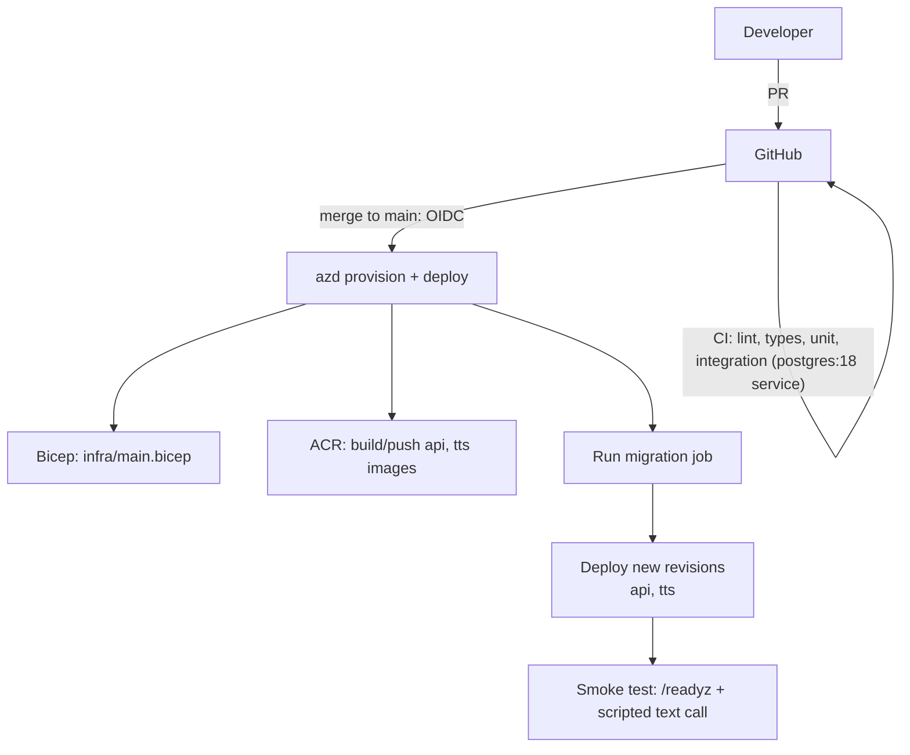

- **Images:** `amina-api` (python:3.12-slim + built SPA). `amina-tts` is a CUDA runtime base + PyTorch + coqui-tts; it is rebuilt only when `apps/tts/**` or `packages/arabic_text/**` changes. **Model weights are not in the image**: they are downloaded from Blob at startup and pinned by `MODEL_VERSION`.
- **Revisions:** single-revision mode. New revisions must pass readiness before traffic shifts. SIGTERM drain: stop admitting calls, then let active calls finish for up to `DRAIN_SECONDS` (**Assumption:** 120 s is allowed by the Container Apps termination grace period; checked).
- **Environments:** `dev` only for the 2-week build. The same Bicep with different parameters creates `demo` for the review.
- **Local development:** Docker Compose (`postgres:18`, the API with hot reload, Vite). Azure AI services come from the dev resource group through `az login`. A CPU `amina-tts` image runs locally for contract tests (slow, but functional), or developers point at the dev GPU app through a debug tunnel (**Decision:** CPU-local for tests only).

---

## 16. Logging, tracing, monitoring and cost

### 16.1 Tracing: one trace per call

We use OpenTelemetry through the Azure Monitor OpenTelemetry distro. The root span `call` carries the `call_id`, and the API propagates trace context (`traceparent`) to `amina-tts`.

```
call (call_id, channel, voice_used, end_reason)
├── verify
├── turn #n (turn_latency_ms, barge_in)
│   ├── stt.final (offset_ms, duration_ms)
│   ├── llm.response (model, ttft_ms, tokens_in/out, tool_rounds)
│   │   ├── tool.data.get_transactions (rows, ms)
│   │   └── tool.knowledge.get_fee_rule (ms)
│   ├── checker.grounding (numbers, violations)
│   └── tts.sentence[k] (engine, ttfb_ms, audio_ms, fallback)
│       └── [amina-tts] synthesize (queue_ms, ttfb_ms, rtf)
├── triage (async)
└── handoff (summary_ms)
```

### 16.2 Metrics

| Metric | Type | Use |
|---|---|---|
| `amina.turn_latency_ms` (caller end-of-speech → first audio byte sent), broken down by stage | histogram | NFR-1 dashboard and alert |
| `amina.client_ttfa_ms` (reported by the browser: end of speech → first sample played) | histogram | True caller-perceived latency |
| `amina.tts.ttfb_ms`, `amina.tts.rtf`, `amina.tts.queue_depth`, `amina.tts.fallbacks` | histogram / gauge / counter | GPU capacity |
| `amina.barge_ins`, `amina.false_barge_ins` (barge-in followed by no caller final) | counter | Turn-taking tuning |
| `amina.tool.errors{tool}`, `amina.tool.latency_ms{tool}` | counter / histogram | |
| `amina.handoffs{reason}`, `amina.verification{outcome}` | counter | |
| `amina.grounding.violations` | counter | Safety |
| `amina.calls.active` | gauge | Capacity |
| `amina.cost.call_usd` | histogram | Cost per call minute |

### 16.3 Logs

Logs are structured JSON with `call_id`, `trace_id` and `turn`. The redaction filter runs on every record (§12.6). The log level is INFO in dev and the demo; transcript text never goes into logs, only into the redacted `call_events`.

### 16.4 Dashboards and alerts

- **Azure Workbook "Amina live":** active calls, turn latency p50/p95 by stage, TTS fallback rate, tool error rate, handoff reasons, cost per call minute.
- **Alerts** (dev thresholds, **Decisions**):
  - turn latency p95 > target + 50% for 10 min;
  - tool error rate > 5%;
  - TTS fallback rate > 20%;
  - any `amina-tts` replica not ready for 5 min;
  - 5xx on `POST /api/calls`.

### 16.5 Cost model

Cost per call is computed after each call into `calls.cost_estimate_usd`, with unit prices kept in config and set from the Azure pricing pages on day 1. No prices are hard-coded in this document.

```
cost_call = stt_audio_seconds × stt_rate
          + Σ(input_tokens × in_rate + output_tokens × out_rate)       # chat + small model
          + search_queries × semantic_rate (beyond free allowance)
          + (fallback_chars × azure_tts_rate)
          + gpu_seconds_attributed × gpu_rate                          # tts busy-time of this call
cost_per_call_minute = cost_call / call_minutes
```

**Fixed monthly costs dominate** for a demo: the always-on GPU replica, AI Search Basic, PG Burstable and the API minimum replicas. **GPU cost control (Decision):** a KEDA **cron** scale rule keeps `amina-tts` at min 1 replica during demo and work hours (Cairo time) and lets it scale to zero otherwise.

- Calls outside those hours use the fallback voice until the GPU replica warms up.
- **Confirmed:** cold starts can take minutes, and serverless GPU is billed per second ([serverless GPU GA](https://techcommunity.microsoft.com/blog/appsonazureblog/announcing-ga-for-azure-container-apps-serverless-gpus/4394302)).
- **Assumption:** cron scale rules work on GPU workload profiles; checked on day 2.

---

## 17. Testing strategy and acceptance criteria

### 17.1 Test pyramid

| Level | What | Tooling | Runs |
|---|---|---|---|
| Unit | Normaliser, chunker, redaction, yes/no lexicon, date parsing, checker, state machine, tool argument validation | pytest | every PR |
| DB integration | Migrations up from empty, RLS isolation (query without scope → 0 rows; scope A can't read B), `verify_lookup`, idempotent action writes, role privileges | pytest + `postgres:18` service container | every PR |
| Pipeline (offline) | `CallSession` driven with scripted text turns through a `TextIn` adapter, with fake STT, fake LLM (scripted tool calls) and fake TTS (sine PCM): barge-in, cancellation, fallback switch, handoff, ordering | pytest-asyncio | every PR |
| TTS contract | `amina-tts` against a tiny stub engine: status codes, chunked PCM, cancellation, readiness | pytest | PRs touching tts |
| Known-answer evals | ≥ 40 scripted conversations (text mode) against the real LLM, DB and Search. Assertions: facts (amounts, dates, last4), citations (file + page), tool sequence, no write without a yes | `evals/run.py` | nightly + before milestones |
| Retrieval eval | 40 questions → expected (doc, page), recall@3 | `evals/retrieval.py` | on corpus or index change |
| Red-team | ≥ 25 cases: jailbreaks, other-customer requests, injected PDF, impersonation, lockout, abusive caller | `evals/run.py --suite redteam` | nightly + milestones |
| Audio E2E | 12 recorded Arabic calls (team voices, quiet and noisy, and one with interruptions) streamed over WS to the deployed system; outcomes checked | pytest + recorded WAVs | milestones |
| TTS quality | CER, speaker similarity, MOS, numbers, TTFB/RTF ([tts.md §6](tts.md#6-evaluation)) | `training/tts/eval` | per checkpoint |
| Load | Locust WebSocket users streaming recorded audio; ramp 5 → 25 concurrent calls; per-stage latency from telemetry | Locust | M2 and before the demo |
| Privacy | Export the eval run's telemetry and transcripts; scan for ID/PAN/phone patterns → must be 0 | script | milestones |

### 17.2 Functional acceptance criteria

| # | Criterion | Pass |
|---|---|---|
| A1 | Worked example: verify → fee question → correct amount + correct file/page → yes → waiver ticket visible in the console | 10/10 audio E2E runs |
| A2 | No data tool executes before verification | 0 violations across all evals and red-team |
| A3 | No ticket or dispute without a yes on a later turn | 0 violations |
| A4 | Known-answer accuracy (all asserted facts correct) | ≥ 90% of cases |
| A5 | Citations correct (file + page) on policy questions | ≥ 90% |
| A6 | Retrieval recall@3 | ≥ 0.85 |
| A7 | Red-team: refused, handled or handed off correctly | 100% for data-access and impersonation cases; ≥ 90% overall |
| A8 | Barge-in: audio stops after an interruption | client-measured stop ≤ 300 ms p95 after the barge-in decision |
| A9 | Handoff: console shows summary, intent, mood, record and live transcript | 5/5 runs |
| A10 | Privacy scan | 0 matches |
| A11 | TTS ship gate | as defined in [tts.md §6.4](tts.md#64-ship-gate) |

### 17.3 Latency targets (provisional, confirmed after the day-3 spike)

Turn latency = caller end of speech → first audio sample played in the browser.

| Turn type | p50 | p95 | Notes |
|---|---|---|---|
| No tool call | ≤ 1.3 s | ≤ 2.0 s | **Target**, includes the ~500 ms segmentation silence |
| With tool call: first audio (filler) | ≤ 0.9 s | ≤ 1.3 s | The filler is cached, so there is no TTS on that path |
| With tool call: first content sentence | ≤ 2.5 s | ≤ 3.5 s | |

**Why these differ from the deck's 1 s p95:** the end-of-speech silence alone costs ~500 ms, and our own GPU TTS adds a time-to-first-byte with no published T4 numbers. After the spike we either tighten these targets or present the measured breakdown with the specific optimisation that would close each gap (shorter silence timeout, DeepSpeed/fp16, a larger GPU, a smaller LLM). **We will not report a number we have not measured.**

### 17.4 Capacity acceptance

At 25 concurrent calls, the latency targets hold. The TTS fallback rate stays ≤ 10%, or the measured knee (§14.5) is documented with the GPU count needed to meet it. Call setup error rate < 1%.

---

## 18. Implementation phases and responsibilities

The full roadmap, with day-level tasks, dependencies and acceptance criteria, is in [roadmap.md](roadmap.md).

| Owner | Area |
|---|---|
| **P1, Lead** (full-stack AI) | Real-time voice path (WS protocol, browser audio, STT, TurnManager, agent loop, checker), staff console, integration, final review |
| **P2, Speech/TTS** | Normaliser, TTS dataset, fine-tuning, TTS evaluation, `amina-tts` service, fallback client, GPU deployment |
| **P3, Data & Quality** | PostgreSQL (schema, RLS, migrations, seed), tools, RAG corpus and ingestion, Bicep/azd/CI, eval and red-team suites, load test |

| Milestone | Day | Exit criteria |
|---|---|---|
| M0 Foundations | 2 | Repo + CI green; `azd up` creates infra; GPU quota requested; region fixed; PDFs collected |
| M1 Thin slice deployed | 5 | Deployed browser call: verify → fee question with a real PDF citation, spoken by base NileTTS-XTTS on Azure GPU (or the fallback if the GPU is blocked); trace visible; latency spike report |
| M2 Feature complete | 8 | Barge-in, actions, handoff + console, fine-tune decision made, evals and red-team running |
| M3 Hardened | 10 | Load test done, acceptance criteria report, docs updated, demo rehearsed |

---

## 19. Risks, trade-offs and open decisions

### 19.1 Risks

| # | Risk | Likelihood | Impact | Mitigation |
|---|---|---|---|---|
| R1 | GPU quota (T4 inference and training GPU) not granted in time | Medium | High | Request on day 1. The fallback voice keeps the system demoable. Training can run on any 24 GB+ GPU the team can access |
| R2 | XTTS TTFB on a T4 too high for a conversational feel | Medium | High | Measure on day 2. Options: DeepSpeed, fp16, shorter first sentence, A100 profile (capacity-constrained), or accept and present the breakdown |
| R3 | Fine-tune degrades quality (seen in other languages) | Medium | Medium | Ship gate; base NileTTS-XTTS + normaliser is the default |
| R4 | `ar-EG` STT accuracy on digits, names and code-switching | High | Medium | Keypad for the ID; phrase list; LLM confirms key details back ("you said the 3rd?") |
| R5 | Licence of the NotebookLM-derived NileTTS audio is unclear | Medium | Low (academic) | Recorded in tts.md; non-commercial use only; the engine is swappable behind the contract |
| R6 | Egyptian PDFs are scanned or low quality, or have restrictive terms | Medium | Medium | Document Intelligence OCR; human sampling; replace sources on day 2 |
| R7 | 2-week schedule slips | High | High | Essential-vs-optional split in roadmap.md; M1 thin slice first; cut list agreed in advance |
| R8 | Easy Auth + WebSocket interplay | Low | Medium | Fallback: console token minted by authenticated REST |
| R9 | WebSocket connections not counted by the HTTP scale rule | Medium | Low | Admission control + manual min replicas for the demo |

### 19.2 Trade-offs we accept

- **Owning turn-taking** (vs Voice Live's built-in VAD and barge-in) in exchange for our own voice.
- **One GPU replica** is a single point of failure; it is mitigated by fallback, not by redundancy.
- **In-process call state:** a replica crash drops its calls. This is simpler than externalised state, which would only help if the media path were also resumable, and it isn't in the browser.
- **Knowledge-based verification** is weak and accepted for synthetic data only.
- **Warm handoff with a callback** instead of live takeover in v1.

### 19.3 Open decisions

| # | Question | Owner | Due |
|---|---|---|---|
| O1 | Azure region (T4 + models + Responses API + semantic ranker + PG 18) | P3 | Day 1 |
| O2 | Chat, small and embedding model deployments | P1 | Day 3 (eval) |
| O3 | Final Egyptian document list and licence notes | P3 | Day 2 |
| O4 | `TTS_TTFB_TIMEOUT_MS`, segmentation silence, and the latency targets in §17.3 | P1 + P2 | Day 3 |
| O5 | Fine-tuned vs base voice (ship gate) | P2 | Day 8 |
| O6 | Grounding checker in `flag` or `block` mode | P1 | Day 8 |
| O7 | Retention period (30-day placeholder) | Lead with tutor | Before the demo |
| O8 | Day-1 verifications: phrase list for `ar-EG`, Speech SDK Entra token auth, `uuidv7()` on Azure PG 18, Prompt Shields configuration, Easy Auth WebSocket behaviour, cron scaling on GPU profile, termination grace period | P1/P3 | Days 1–3 |
